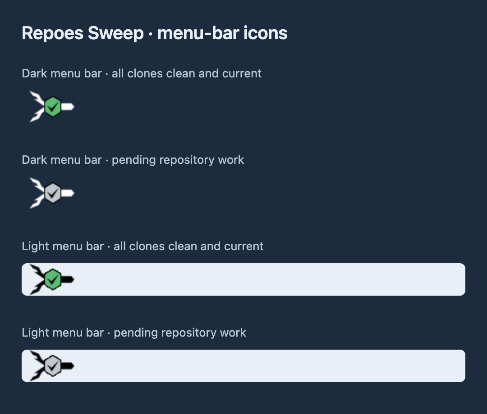
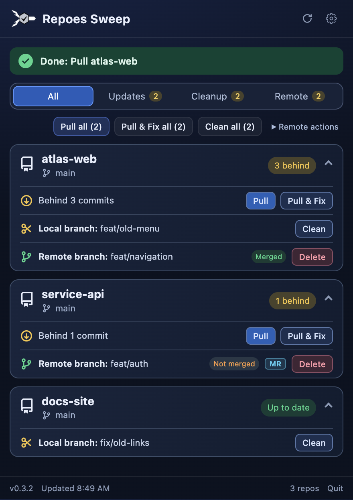
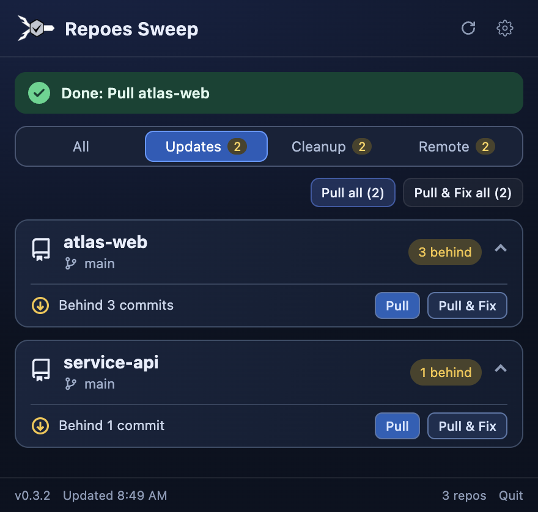
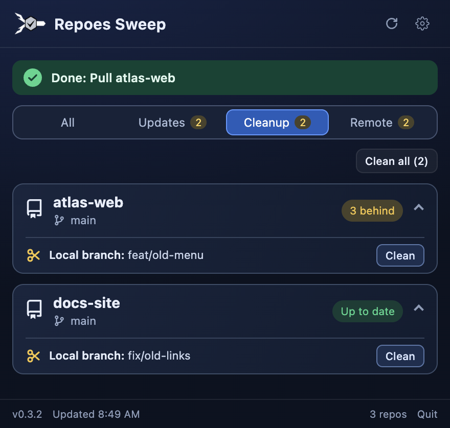
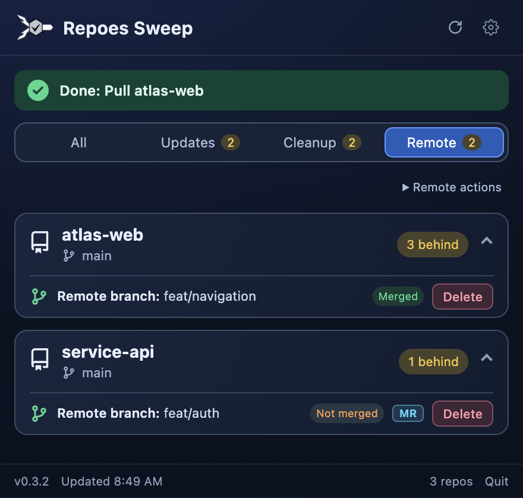
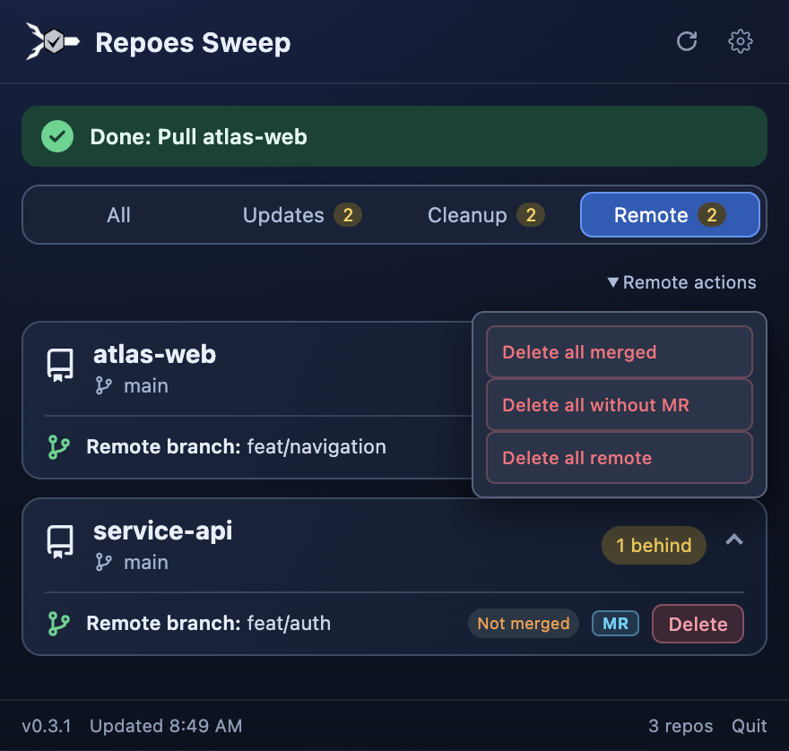
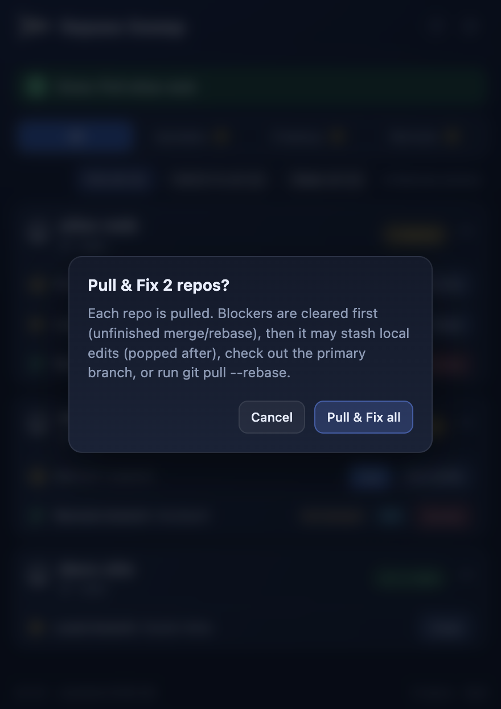
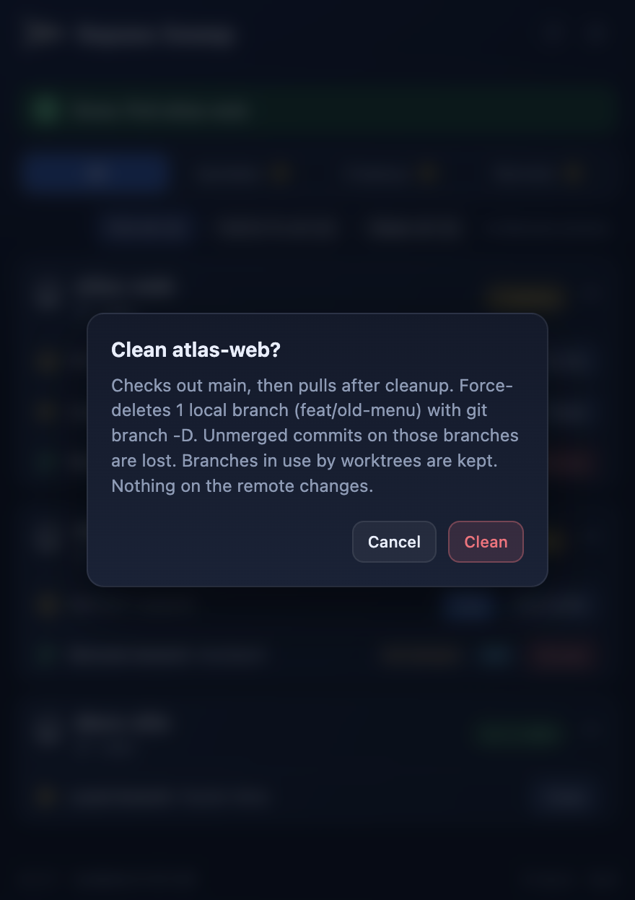
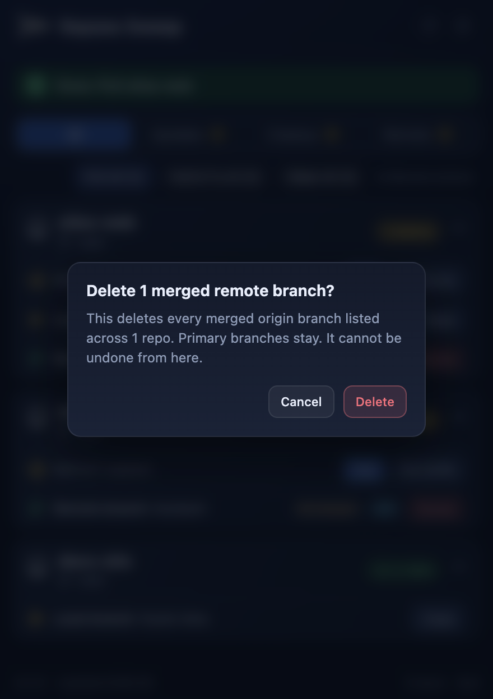
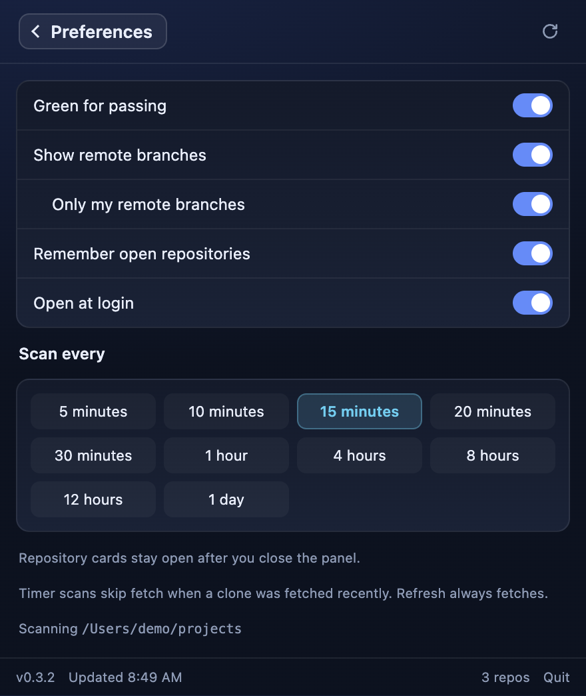

# Repoes Sweep

Repoes Sweep is a tray app for **macOS** and **Windows** that watches the git clones on your machine and lets you catch them up from one panel. It fetches each clone, then shows what is behind, which local branches are left over, and which remote branches are still on `origin`.

The panel is a dark inbox that opens from the menu-bar icon (Mac) or the system-tray icon (Windows). Repository cards start expanded. Clicking away closes the panel, and the next open starts expanded again.

Git has to already work in a terminal for those clones. The app does not install git and it does not store a password or a token.

> **Electron is the cross-platform app.** It lives at the repo root (`electron/`, `src/ui/`, `scripts/`). The original Swift menu-bar app is still in `menubar/` and still builds, but new work goes into the Electron app. The Swift copy will be removed once the Electron build has fully replaced it.


## Menu-bar previews

The actual winged mark uses a green diamond when clones are clean/current and gray when work remains. Both dark- and light-menu-bar artwork are shown.

<a href="docs/screenshots/menu-bar.png"></a>

The labeled sheets enlarge the app’s actual rendered artwork 2× for detail. The neutral backdrops are presentation surfaces, not captures of a personal desktop.

[Full menu-bar gallery and regeneration instructions](docs/menu-bar.md)

Local cleanup respects linked Git worktrees: branches in use are retained and excluded from Clean. If the primary branch belongs to another worktree, unused branches can be cleaned without switching or pulling either worktree. The confirmation lists the branches that may be deleted. Repos with only protected worktree branches stay out of the attention list, and repos without commits are treated as neutral.

## Screenshots

Screenshots of the current Electron interface on macOS, using fictional projects, accounts, jobs, and values. No personal data or live credentials are used.

<a href="docs/screenshots/overview.png"></a>

The repo workbench groups updates, local cleanup, and remote branches in each repository card. Use All, Updates, Cleanup, or Remote to focus the list. Successful operations show a green completion banner; failures and running operations have distinct banners.

<a href="docs/screenshots/updates-filter.png"></a>
<a href="docs/screenshots/cleanup-filter.png"></a>
<a href="docs/screenshots/remote-filter.png"></a>

The gallery includes detail views, settings, and confirmations. Click an image for the full-resolution capture.

<details>
<summary>View dashboard screenshots</summary>

| Overview | Remote Branches |
| --- | --- |
| <a href="docs/screenshots/overview.png"></a><br>Out-of-date clones, cleanup candidates, and remote branches. | <a href="docs/screenshots/remote-branches.png"></a><br>Remote branch states, MR badges, and per-branch or bulk actions. |

| Pull Fix Confirmation | Cleanup Confirmation |
| --- | --- |
| <a href="docs/screenshots/pull-fix-confirmation.png"></a><br>Pull & Fix explains the recovery steps before applying them. | <a href="docs/screenshots/cleanup-confirmation.png"></a><br>Local cleanup confirmation names the branches and describes its effect. |

| Remote Delete Confirmation | Settings |
| --- | --- |
| <a href="docs/screenshots/remote-delete-confirmation.png"></a><br>Remote deletion has a separate confirmation. | <a href="docs/screenshots/settings.png"></a><br>All preferences and scan interval choices. |

</details>

[How these screenshots are made](docs/screenshots/README.md)

---

## Requirements

### Both platforms

- [Node.js](https://nodejs.org/) **20 or newer** (includes `npm`), to build and install from source
- Git on `PATH`, already able to `fetch` and `push` for your clones
- Optional: [`glab`](https://gitlab.com/gitlab-org/cli), signed in to gitlab.com, for the **MR** badges

### macOS

- macOS **13** (Ventura) or later, Apple Silicon or Intel

### Windows

- Windows **10** or **11**
- PowerShell 5+ (built in) to run the install script
- [Git for Windows](https://git-scm.com/download/win)
- Ability to run an unsigned, locally built NSIS installer (SmartScreen may warn on first run)

---

## Install on macOS

```bash
node -v   # v20.x or newer; otherwise: brew install node
git clone https://github.com/krisrmgua/RepoesSweep.git
cd RepoesSweep
./scripts/install.sh
```

What `install.sh` does:

1. `npm install`
2. `npm run pack:mac` (electron-builder, output under `release/`)
3. Stops the Swift app if it is running and removes its `com.kris.repos` LaunchAgent
4. Copies `Repoes Sweep.app` to `~/Applications/Repoes Sweep.app` (replacing the Swift copy) and ad-hoc signs it
5. Writes a helper CLI to `~/bin/repoes-sweep`
6. Launches the app

The first build downloads Electron (about 100 MB) and can take a few minutes. Run `./scripts/install.sh` again to update.

Start at login is handled by the app itself (**Preferences → Open at login**, on by default), not by a LaunchAgent.

```bash
repoes-sweep start    # open ~/Applications/Repoes Sweep.app
repoes-sweep stop     # quit it
repoes-sweep status   # running | stopped
```

If `repoes-sweep` is not found, add `~/bin` to your PATH (`echo 'export PATH="$HOME/bin:$PATH"' >> ~/.zprofile`).

This is an ad-hoc local build, not notarized. If macOS blocks the first launch, right-click the app in `~/Applications` and choose **Open**, or allow it in **System Settings → Privacy & Security**.

## Install on Windows

```powershell
node -v   # v20.x or newer; otherwise install Node LTS from nodejs.org
git clone https://github.com/krisrmgua/RepoesSweep.git
cd RepoesSweep
.\scripts\install.ps1
```

If PowerShell blocks scripts, run `Set-ExecutionPolicy -Scope CurrentUser RemoteSigned` once, then rerun.

What `install.ps1` does:

1. `npm install`
2. `npm run pack:win` (builds `release\Repoes Sweep Setup <version>.exe`)
3. Stops a running copy, then launches the setup wizard and waits for it

After setup, Repoes Sweep appears in the **system tray** near the clock. Windows often hides new tray icons: click the **^** overflow arrow and drag it onto the taskbar. If SmartScreen says "Windows protected your PC", choose **More info → Run anyway** for a build you made yourself.

Update by pulling and rerunning `.\scripts\install.ps1`. Uninstall from **Settings → Apps → Repoes Sweep**. Preferences under `%APPDATA%\Repoes Sweep` stay until you delete that folder.

---

## Git on this machine

Repoes Sweep runs `git` as you, without a shell. Whatever already works for `git fetch` and `git push` in a terminal is what the app uses: an SSH key, a credential helper, Git Credential Manager, or a signed-in host. It never asks for a password of its own and it never writes a credential file. `GIT_TERMINAL_PROMPT=0` is set so a missing login fails fast instead of hanging.

Check that before you rely on the panel:

```bash
git -C ~/git-repos/example status
git -C ~/git-repos/example fetch --prune origin
```

If those fail, the panel fails the same way. Fix the login in git, not in Repoes Sweep.

On macOS, Homebrew (`/opt/homebrew/bin`, `/usr/local/bin`) is added to the front of `PATH`, because an app started from Finder does not inherit your shell PATH. On Windows the normal user `PATH` is used, which is where Git for Windows and `glab` install themselves.

## Which clones it watches

On each scan it walks one root directory and treats every folder with a `.git` entry as a clone. It skips `node_modules` and `.terraform*`, and does not descend into a clone once found.

The root is the first of these that is set and exists:

1. `MYGIT_REPO_ROOT` or `REPOS_TOOLBELT_ROOT` (only seen when the app is started from a terminal that has them)
2. The first line of `~/.config/mygit/repo-root` (`%USERPROFILE%\.config\mygit\repo-root` on Windows)
3. `~/git-repos` (`%USERPROFILE%\git-repos` on Windows)

The root in use is shown at the bottom of Preferences. An empty repo is reported and left out of the action lists. A detached HEAD stays on the list with Clean: a linked worktree is removed from disk, and a normal checkout is switched to the primary branch and pulled. Removal refuses a worktree that has uncommitted files.

## How the panel works

A scan runs when the app launches, on the interval you pick, and when you press refresh. Opening the panel also scans if the last one is more than two minutes old. Scans fetch `origin` with `--prune`, up to eight clones at a time. Pull, Pull & Fix, Clean, remote deletes, and the matching "all" actions run one job at a time. A repo leaves the list as soon as its job succeeds. A rescan runs once the queue is empty and corrects anything the live update missed. While jobs run, the overview shows the current action and, for a batch, `N of M` plus how many are left.

The overview has three sections. The count stays on the header while the section is collapsed.

### Out of date

A clone is listed when the current branch is behind its upstream, or when the upstream branch was deleted (`gone`).

- **Pull** runs `git pull --ff-only`, then a plain `git pull` if fast-forward is rejected.
- **Pull & Fix** tries to get past the usual blocks:
  - unfinished merge/rebase/cherry-pick/revert, or a stuck conflicted index: abort it (`merge --abort` / `rebase --abort` / …, or `reset --merge` when `MERGE_HEAD` is already gone) so stash and pull can run
  - upstream gone: check out the primary branch (`main` or `master`, or `origin/HEAD`) and pull
  - local edits in the way: stash them, including untracked files, pull, then pop the stash
  - local and remote diverged: `git pull --rebase`
- **Pull all** queues one pull per listed clone. **Pull & Fix all** asks first, then queues one job per listed clone.

A stash created here is labeled `Repoes Sweep auto-stash` or `Repoes Sweep before checkout primary`. If the pop conflicts, the changes stay in `git stash` and the panel says so. Aborting a conflicted merge discards that unfinished merge; ordinary unstaged edits are kept when git can.

### Cleanup

A clone is listed when it has local branches other than the primary branch.

**Clean** and **Clean all** ask first. Clean checks out the primary branch (stashing local edits if needed), deletes every other local head with `git branch -D`, then pulls with `--ff-only`. It re-reads branches at clean time, so an already-gone name is not an error. Branches checked out in another worktree are reported and skipped. `-D` deletes the branch even when it is not merged. This does not delete anything on the remote.

A detached HEAD has its own **Clean**. On a linked worktree that removes the worktree with `git worktree remove` and leaves the main checkout alone. Git refuses when the worktree has uncommitted files or is locked, and the panel reports that instead of forcing the delete. On a normal checkout it checks out the primary branch and pulls.

### Remote branches

Shown when **Show remote branches** is on. Each clone lists `origin` branches other than the primary, marked **merged** when that tip is reachable from `origin/<primary>`.

**Only my remote branches** (on by default, nested under that preference) keeps tips whose author email matches the clone's `user.email`. Turn it off to see every `origin` branch again.

Branches with an open GitLab merge request you authored show a small **MR** badge next to the name (one `glab api graphql` call per scan when the section is on). Without `glab` the badges are simply absent.

**Delete**, per-repo **Delete all**, and section-wide **Delete all** / **Delete all merged** / **Delete all without MR** ask first, then run `git push origin --delete` for those names. Only branches from the last scan can be deleted, the primary branch is never in the list, and a name that matches it is refused. This removes the branch on the remote. It cannot be undone from the app.

## Tray icon

The mark is the bolt, the diamond, and the tail. The diamond has a black outline and a black check.

- **Light gray** while any clone is out of date or has extra local branches.
- **Green** when those two are empty and **Green for passing** is on. Remote branches do not keep the diamond gray.

The bolts and the tail follow the system theme: light in dark mode, dark in light mode. **Dark menu-bar background** draws a dark rounded backdrop behind the mark and keeps the bolts light. Hover the icon for `N behind · N cleanup · N remote`. Right-click for **Open**, **Refresh**, and **Quit**.

## Preferences

| Item | Default |
|---|---|
| Green for passing | On. The diamond can turn green, and a merged remote branch is shown in green. |
| Show remote branches | On. Hides the Remote branches section when off. |
| Only my remote branches | On. Shown under Show remote branches. Keeps tips authored by this clone's `user.email`. |
| Dark menu-bar background | Off. On draws a dark rounded backdrop behind the menu-bar mark. |
| Open at login | On. Registers the installed app as a login item (macOS and Windows). |
| Scan every | 10 minutes. Choices run from 5 minutes to 1 day. Timer scans skip `git fetch` when FETCH_HEAD is still fresh; the refresh button always fetches. |

Preferences are a small JSON file. They are not credentials.

| OS | Path |
|---|---|
| macOS | `~/Library/Application Support/Repoes Sweep/data/prefs.json` |
| Windows | `%APPDATA%\Repoes Sweep\data\prefs.json` |

On the first Electron launch on a Mac, values from the Swift app (UserDefaults under `com.kris.repos`) are copied over once. The app id is still `com.kris.repos`.

## Keyboard

- **Esc** closes the panel, or leaves Preferences
- **⌘Q** / **Ctrl+Q** quits

---

## Develop

```bash
npm install
npm run dev     # Vite on :5173 + Electron with REPOES_DEV=1 (blur does not hide the panel)
npm run build   # copy mark layers, typecheck, Vite build, compile electron/
npm start       # build, then run Electron against dist/
```

| Script | Purpose |
|---|---|
| `npm run build` | Mark assets + typecheck + UI + Electron compile |
| `npm run pack:mac` | macOS `.app` + zip under `release/` |
| `npm run pack:win` | Windows NSIS installer under `release/` |
| `npm run pack` | Both (needs a toolchain that can build both) |

`npm run dev` uses POSIX env syntax; on Windows use `npm start`, or set `REPOES_DEV=1` yourself before `electron .`.

## Layout

| Path | What |
|---|---|
| `electron/` | Main process: tray, panel window, git model, job queue, prefs |
| `src/ui/` | Panel HTML, CSS, and TypeScript |
| `assets/mark/` | Menu-bar mark layers (wings, diamond, outline, check), copied from `menubar/Resources/` at build |
| `scripts/` | `install.sh` (macOS), `install.ps1` (Windows), `copy-mark.mjs` |
| `menubar/` | Legacy Swift Package Manager app (macOS only); see below |

### Legacy Swift app

```bash
cd menubar
swift build
./make-app.sh && open "Repoes Sweep.app"
./install.sh   # installs to ~/Applications with a LaunchAgent
```

`RepoesSweep --dump` prints each clone after a real fetch. `RepoesSweep --pull-fix <path>` runs Pull & Fix on one clone. Both use your real checkouts. Do not run the Swift and Electron installers side by side: both install `~/Applications/Repoes Sweep.app`.

## Version

The shipping version lives in `package.json` → `version`. Electron Builder embeds it, so the panel footer/header (`vX.Y.Z`) matches `app.getVersion()`.

**Do not bump the version in feature PRs.** Every merge to `main` runs [`.github/workflows/bump-version.yml`](.github/workflows/bump-version.yml), which:

1. Bumps the **patch** (for example `0.3.9` → `0.3.10`)
2. Opens a short-lived release PR and squash-merges it as `chore: release X.Y.Z [skip ci]`
3. Tags `vX.Y.Z` on `main`

The `[skip ci]` marker stops the bump job from looping on its own commit.


## License

[MIT](LICENSE). Copyright 2026 Kristopher Simmons.

## Contributing

Issues and pull requests are welcome. See [CONTRIBUTING.md](CONTRIBUTING.md), [CODE_OF_CONDUCT.md](CODE_OF_CONDUCT.md), and [SECURITY.md](SECURITY.md). `main` only accepts changes through a pull request.

### Cleanup regression checks

Run `npm run build:electron` followed by `node scripts/worktree-clean-selftest.mjs`. The tests use temporary repos and a local bare remote to verify worktree ownership, preserved edits, stale requests, confirmation scope, normal cleanup, and pull-error reporting.
