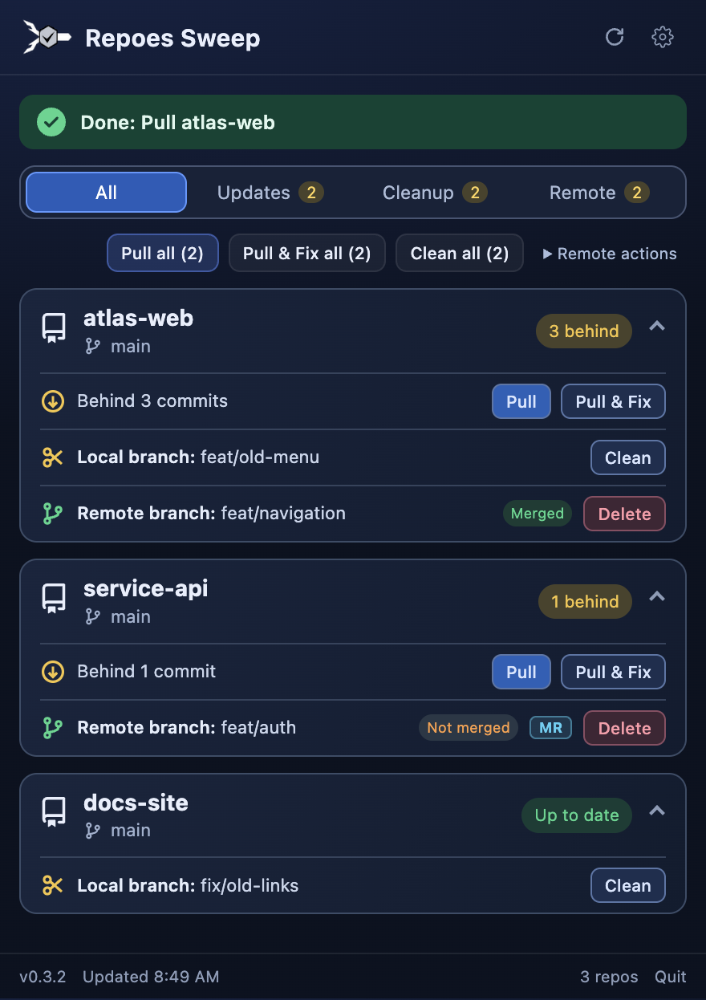
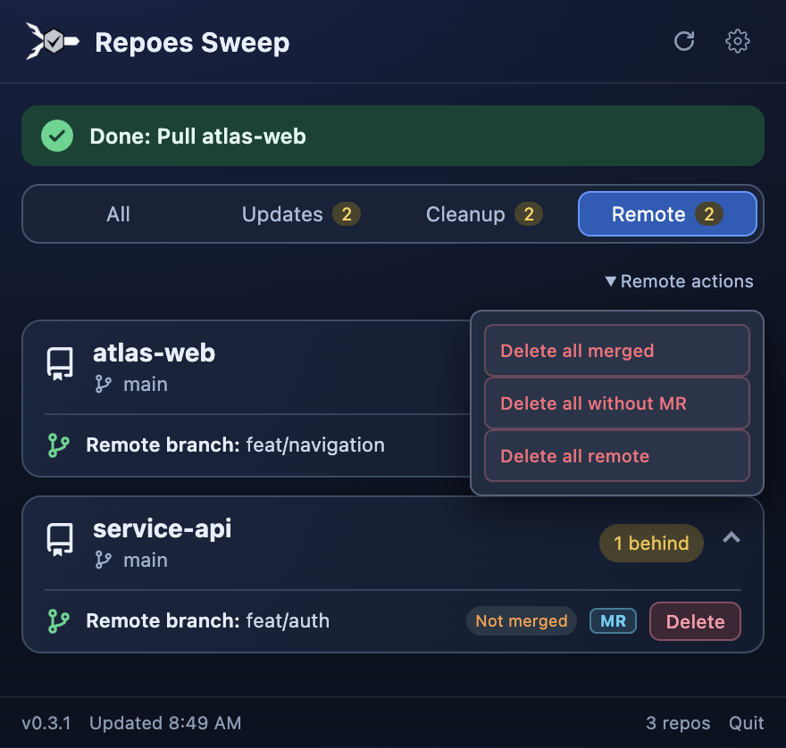
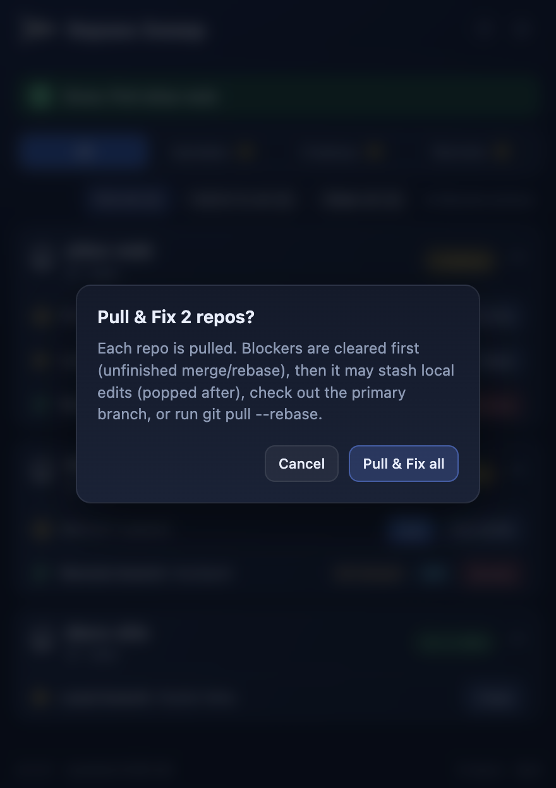
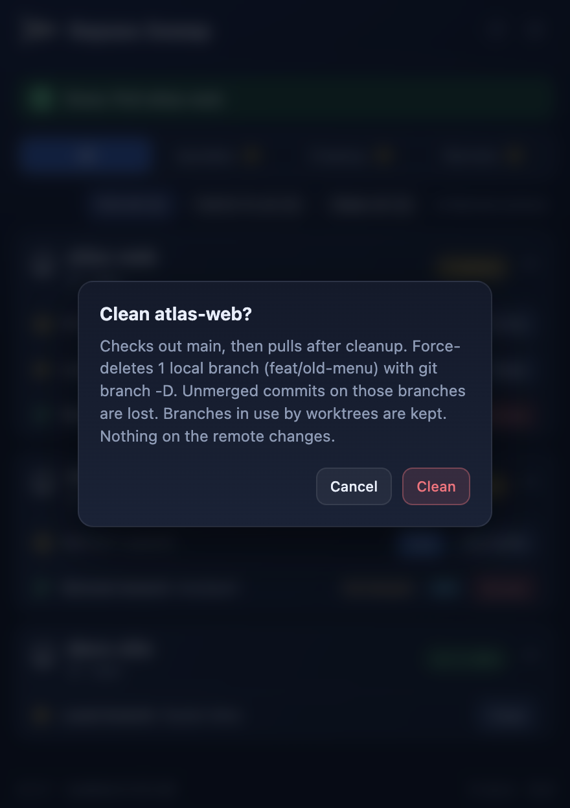
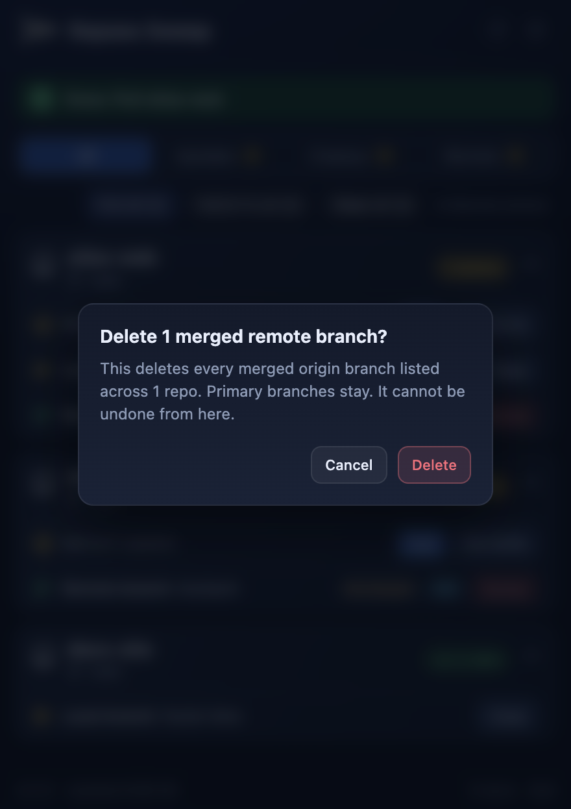
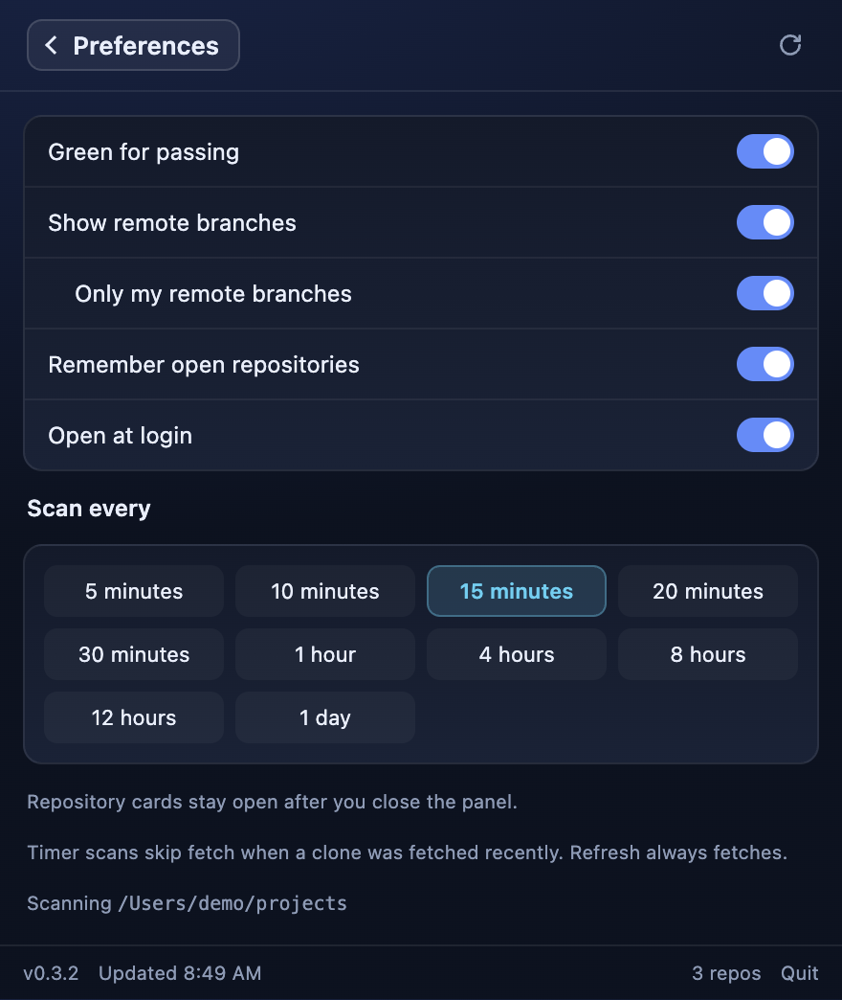

# Screenshot gallery

Screenshots of the current Electron interface on macOS, using fictional projects, accounts, jobs, and values. No personal data or live credentials are used.

These are captures of `dist/index.html` built from the repository’s actual `src/ui` code. The layout, typography, colors, controls, and dialogs come from the app. A separate Electron entry point supplies synthetic state through a mock preload bridge; it never starts the production main process. Network requests are blocked, and application data goes to a temporary directory. Actions such as run, delete, merge, refresh, and save are inert.

No installed app, sign-in, API key, real repository scan, market-data request, or scheduled command is needed. Example stock prices, allowance percentages, balances, and positions are illustrative. There are no AI-generated interface images.

Captured from version **0.2.2**, source revision `a3fb6d9`.


## Menu-bar icons and views

[Open the complete menu-bar gallery](../menu-bar.md), including the actual icon artwork and supported display states.


## Recreate

From the repository root, after installing dependencies:

```bash
npm install
npm run build:ui
npm run build:electron
npx electron scripts/screenshots.cjs
```

Run this on macOS with a graphical session for the same fonts and platform controls. The capture window is hidden and uses a 2× device scale. Other platforms can render different fonts and native controls. Dates and relative times are sample data and may differ when recaptured.

`scripts/screenshots/fixture.cjs` defines every sample and the click sequence. `preload.cjs` provides the isolated mock bridge. `manifest.json` lists each image, its purpose, and its pixel size. Do not replace the fixture bridge with the production preload when capturing public documentation.

## Views

### Overview

Out-of-date clones, cleanup candidates, and remote branches.



### Remote Branches

Remote branch states, MR badges, and per-branch or bulk actions.



### Pull Fix Confirmation

Pull & Fix explains the recovery steps before applying them.



### Cleanup Confirmation

Local cleanup confirmation names the branches and describes its effect.



### Remote Delete Confirmation

Remote deletion has a separate confirmation.



### Settings

All preferences and scan interval choices.


